<div align="center">

<p align="center">
  
</p>

# 🚀 Awesome App Marketplace Platform 🏪

<p align="center">
  <a href="https://github.com/ishandutta2007/Awesome-Awesome-Awesome"></a>
  <a href="https://discord.gg/jc4xtF58Ve"></a>
  <a href="https://github.com/ishandutta2007/Awesome-App-Marketplace-Platform/stargazers"></a>
  <a href="https://github.com/ishandutta2007/Awesome-App-Marketplace-Platform/network/members"></a>
  <a href="https://github.com/ishandutta2007/Awesome-App-Marketplace-Platform/blob/main/LICENSE"></a>
  <a href="https://github.com/ishandutta2007"></a>
</p>

**Curated collection of production-grade SaaS platforms, self-hosted open-source software registries, federated app stores, and multi-vendor marketplace engines. 🌟 Star this repo to bookmark! 🌟**

<p align="center">
  <em>Discover enterprise ecosystem marketplaces, VS Code extension registries, sandboxed app centers, decentralized software distributors, and developer-first multi-vendor commerce engines.</em>
</p>

<p align="center">
  <strong>Last updated: October 2026</strong> • Maintained by <a href="https://github.com/ishandutta2007">@ishandutta2007</a>
</p>

</div>

---

## 📑 Table of Contents

- [🔍 Sector Overview & Market Dynamics](#-sector-overview--market-dynamics)
- [☁️ SaaS & Enterprise Hosted Platforms](#️-saas--enterprise-hosted-platforms)
- [💻 Open-Source GitHub Projects](#-open-source-github-projects)
- [🛠️ Architecture Patterns for Custom Marketplaces](#️-architecture-patterns-for-custom-marketplaces)
- [📈 Star History](#-star-history)
- [🤝 How to Contribute](#-how-to-contribute)
- [💖 Support & Sponsor](#-support--sponsor)
- [⚠️ Disclaimer](#️-disclaimer)

---

## 🔍 Sector Overview & Market Dynamics

The global cloud marketplace and application ecosystem accounts for an estimated market size exceeding **$850B–$1T+** in underlying cloud/software transactions, expanding at a CAGR of **~15–16%** through 2026. 

The marketplace infrastructure sector exhibits a distinct structural duality:
- 🏛️ **Platform / Infrastructure Layer (Oligopolistic & Concentrated):** Foundational distribution channels and enterprise storefronts are heavily dominated by hyperscalers and ecosystem giants (*Alphabet, Amazon, Salesforce, Shopify*), creating a "winner-take-all" gravity where software procurement converges on pre-committed enterprise budgets.
- 🧩 **Application / Developer Layer (Massively Fragmented):** Hundreds of thousands of Independent Software Vendors (ISVs), developer tool creators, and SaaS startups distribute plug-ins and integrations across these channels with no single vendor monopolizing any individual product category.

---

## ☁️ SaaS & Enterprise Hosted Platforms

A breakdown of leading commercial app stores and partner ecosystem platforms, sorted descending by operator valuation / market capitalization:

| Platform | Parent Operator | Valuation / Market Cap 🏢 | Starting Pricing 💳 | Free Tier / Trial Limits 🎁 | Best For 🎯 |
|---|---|---|---|---|---|
| **[Google Workspace Marketplace](https://workspace.google.com/marketplace)** | Alphabet (Google) | ~$4.2T+ Market Cap | $0 listing fee; 0% commission on direct external developer billing | **Free forever:** Free app publication & install; external SaaS billing handles paid licensing | Developers building Google Workspace add-ons & Docs/Sheets integrations |
| **[AWS Marketplace](https://aws.amazon.com/marketplace)** | Amazon (AWS) | ~$2.7T+ Market Cap | $0 listing fee; 3.0% transaction fee for SaaS public offers (20% for AMIs/containers) | **Free forever:** Free listings & free software offers; free trials configurable by seller | Enterprise software vendors selling via committed AWS cloud budgets |
| **[Shopify App Store](https://apps.shopify.com/)** | Shopify | ~$210B+ Market Cap | $19 one-time registration fee; 0% revenue share on first $1,000,000 lifetime revenue (15% thereafter + 2.9% payment processing) | **Free forever:** Keep 100% of revenue up to $1,000,000 lifetime gross threshold | Developers building e-commerce extensions for Shopify merchants |
| **[Salesforce AppExchange](https://appexchange.salesforce.com/)** | Salesforce | ~$200B+ Market Cap | $0 partner signup; $999 one-time paid security review; 15% revenue share on Checkout | **Free forever:** Free app listings require no security review fee ($0 partner tier) | Enterprise ISVs & CRM partners targeting Salesforce customers |
| **[Stripe App Marketplace](https://marketplace.stripe.com/)** | Stripe | ~$159B Private Valuation | $0 listing fee; 0% platform commission on external subscriptions (standard 2.9% + $0.30 payment processing applies) | **Free forever:** Free app submission, listing, and direct billing handling | Fintech & payment workflow developers integrating into Stripe Dashboard |
| **[Slack App Directory](https://slack.com/apps)** | Salesforce (Slack) | Included in Salesforce (~$200B) | $0 listing fee; 0% revenue share (developers bill externally) | **Free forever:** Free directory listing and workspace distribution | Developers building collaboration bots & workplace automation |
| **[QuickBooks App Store](https://apps.intuit.com/)** | Intuit | ~$90B+ Market Cap | $0 listing fee; 0% revenue share on app subscriptions; unmetered Core APIs free | **Free forever:** Free *Builder* tier with unmetered Core APIs; paid monthly tiers only for higher CorePlus read volumes | Fintech & accounting software developers serving SMBs |
| **[Atlassian Marketplace](https://marketplace.atlassian.com/)** | Atlassian | ~$55B+ Market Cap | $0 listing fee; 0% revenue share on Forge apps up to $1M lifetime revenue (16%–17% standard Forge; 20%–25% for Connect apps) | **Free forever:** Free apps listed at zero cost; 0% take-rate on first $1,000,000 lifetime Forge revenue | Developers building extensions for Jira, Confluence, and Atlassian tools |
| **[Zendesk Marketplace](https://www.zendesk.com/marketplace/)** | Hellman & Friedman / Permira (Zendesk) | ~$10.2B Acquisition Valuation | $0 listing fee; 0% platform take-rate (developers connect own Stripe account; standard Stripe processing applies) | **Free forever:** Free app listings & free installations; developers control external Stripe tiers | Customer experience & support software developers |

---

## 💻 Open-Source GitHub Projects

Explore open-source app stores, extension registries, federated directories, and multi-vendor engines. **Sorted in descending order by GitHub stargazers:**

### 1. **[Komi Store (formerly GitHub Store)](https://github.com/komi-store/komi-store)** [](https://github.com/komi-store/komi-store/stargazers)
- 📦 **Type:** Cross-Platform App Store Client & Release Hub (GPL-3.0)
- ⚡ **Overview:** A modern cross-platform application store for discovering, installing, and auto-updating software releases directly from developer forges (GitHub, Codeberg, Forgejo, Gitea).
- 🛠️ **Tech Stack:** Dart, Flutter (Android, Windows, macOS, Linux).
- 🎯 **Best For:** End-users and open-source software enthusiasts seeking a unified, decentralized GUI app store for open-source desktop and mobile applications.

---

### 2. **[Sandstorm](https://github.com/sandstorm-io/sandstorm)** [](https://github.com/sandstorm-io/sandstorm/stargazers)
- 📦 **Type:** Self-Hosted Sandboxed Web App Marketplace (Apache 2.0)
- ⚡ **Overview:** Open-source platform for running self-hosted web applications with security-hardened isolation. Includes an integrated app marketplace with one-click app installs, single sign-on across all apps, and fine-grained access control.
- 🛠️ **Tech Stack:** C++, Cap'n Proto, Linux Containers, JavaScript.
- 🎯 **Best For:** Organizations, home-labbers, and privacy-conscious teams needing a secure personal cloud and private web app store.

---

### 3. **[Sharetribe](https://github.com/sharetribe/sharetribe)** [](https://github.com/sharetribe/sharetribe/stargazers)
- 📦 **Type:** Open-Source Marketplace Engine (Custom Community Edition / Commercial)
- ⚡ **Overview:** One of the most battle-tested open-source platforms for building custom peer-to-peer and multi-vendor marketplaces. Features transactional workflows, availability calendars, messaging, and multi-seller checkout.
- 🛠️ **Tech Stack:** Ruby on Rails, React, Node.js.
- 🎯 **Best For:** Developers launching two-sided multi-vendor platforms, asset-sharing registries, or developer service marketplaces.

---

### 4. **[Accrescent](https://github.com/accrescent/accrescent)** [](https://github.com/accrescent/accrescent/stargazers)
- 📦 **Type:** Security & Privacy-Focused Android App Store (GPL-3.0)
- ⚡ **Overview:** A novel alternative Android app store focused on modern security standards, reproducible builds, and developer identity verification without tracking user telemetry.
- 🛠️ **Tech Stack:** Kotlin, Jetpack Compose, Material 3, Android.
- 🎯 **Best For:** Android developers looking for an alternative app distribution channel that enforces cryptographically secure app signing and transparent review.

---

### 5. **[Websoft9](https://github.com/websoft9/websoft9)** [](https://github.com/websoft9/websoft9/stargazers)
- 📦 **Type:** Cloud-Native App Store & Application Lifecycle Platform (LGPL-3.0)
- ⚡ **Overview:** An enterprise-ready application hosting platform and cloud-native software marketplace panel containing over 200+ pre-packaged open-source web applications with automated Docker Compose deployments.
- 🛠️ **Tech Stack:** Python, Vue.js, Docker, Linux, Shell.
- 🎯 **Best For:** DevOps teams, cloud hosting providers, and system administrators building an internal app catalog for automated server deployments.

---

### 6. **[Open VSX](https://github.com/eclipse/openvsx)** [](https://github.com/eclipse/openvsx/stargazers)
- 📦 **Type:** Vendor-Neutral Extension Registry (EPL-2.0)
- ⚡ **Overview:** The premier vendor-neutral open-source alternative to Microsoft's Visual Studio Marketplace, serving over 600M+ extension downloads monthly. Powers the extension ecosystem for VSCodium, Eclipse Theia, Gitpod, and cloud IDEs.
- 🛠️ **Tech Stack:** Java, Eclipse Vert.x, PostgreSQL, Redis, TypeScript.
- 🎯 **Best For:** IDE creators, tooling teams, and enterprise dev platforms requiring a sovereign, vendor-neutral extension registry.

---

### 7. **[Mercur](https://github.com/mercurjs/mercur)** [](https://github.com/mercurjs/mercur/stargazers)
- 📦 **Type:** Headless Multi-Vendor Marketplace Engine (MIT / Enterprise Modules)
- ⚡ **Overview:** A headless marketplace platform built on Medusa.js. Includes comprehensive vendor onboarding workflows, multi-vendor carts with automated order splitting, commission calculations, and automated payouts via Stripe Connect.
- 🛠️ **Tech Stack:** Medusa.js, Node.js, TypeScript, PostgreSQL, Redis, React.
- 🎯 **Best For:** Developers building bespoke commerce and paid plugin marketplaces wanting full code ownership and zero per-transaction vendor lock-in.

---

### 8. **[Flathub](https://github.com/flathub/flathub)** [](https://github.com/flathub/flathub/stargazers)
- 📦 **Type:** Universal Linux App Store Infrastructure (GPL-2.0 & Open Metadata)
- ⚡ **Overview:** The central build, validation, and distribution infrastructure powering Flathub—the primary app store for Linux desktop applications packaged via Flatpak.
- 🛠️ **Tech Stack:** Python, Flatpak, OSTree, BuildStream.
- 🎯 **Best For:** Linux developers and distribution maintainers establishing sandboxed software distribution channels across desktop Linux distributions.

---

### 9. **[F-Droid Server](https://github.com/F-Droid/fdroidserver)** [](https://github.com/F-Droid/fdroidserver/stargazers)
- 📦 **Type:** Decentralized App Repository Build & Signing Server (AGPL-3.0)
- ⚡ **Overview:** The official server tools for building, updating, and signing F-Droid-compatible Android package repositories. Enables anyone to publish and operate a custom federated mobile app repository.
- 🛠️ **Tech Stack:** Python, Android SDK, Bash.
- 🎯 **Best For:** Organizations running private or specialized Android app repositories with deterministic, verifiable builds.

---

### 10. **[Code Extension Marketplace (Coder)](https://github.com/coder/code-marketplace)** [](https://github.com/coder/code-marketplace/stargazers)
- 📦 **Type:** Lightweight Self-Hosted Extension Registry (AGPL-3.0)
- ⚡ **Overview:** A single-binary VS Code extension marketplace designed specifically for air-gapped and high-security enterprise networks. Serves extensions directly from local disk or Artifactory via the VS Code Extension API.
- 🛠️ **Tech Stack:** Go, Docker, Kubernetes Helm.
- 🎯 **Best For:** Regulated and air-gapped engineering environments needing an isolated internal extension mirror without internet egress.

---

### 11. **[World Vibe Web (WVW)](https://github.com/f/wvw.dev)** [](https://github.com/f/wvw.dev/stargazers)
- 📦 **Type:** Federated Open-Source App Catalog & Indexer (MIT)
- ⚡ **Overview:** A federated app store architecture for open-source web and desktop projects. Individual developers host their own `apps.json` manifest on GitHub; WVW indexes, verifies stars/metrics, and aggregates them into a decentralized catalog without central gatekeeping.
- 🛠️ **Tech Stack:** TypeScript, GitHub Actions, Static Site Generation, Tauri + Rust.
- 🎯 **Best For:** Open-source creators seeking zero-fee federated distribution without proprietary review queues.

---

### 12. **[BotHive](https://github.com/rishabh3562/BotHive)** [](https://github.com/rishabh3562/BotHive/stargazers)
- 📦 **Type:** AI Agent & Automation Marketplace (MIT)
- ⚡ **Overview:** A specialized vertical marketplace connecting automation builders and buyers. Supports publishing automation workflows (Make, Zapier, n8n), paid subscriptions, downloadable configs, and developer profile leaderboards.
- 🛠️ **Tech Stack:** Next.js 14, TypeScript, Supabase, Stripe, Tailwind CSS.
- 🎯 **Best For:** Developers launching specialized vertical marketplaces tailored to generative AI agents, prompts, and automation flows.

---

### 13. **[Tujjar Marketplace Module](https://github.com/dev-taherm/Tujjar)** [](https://github.com/dev-taherm/Tujjar/stargazers)
- 📦 **Type:** Django-Based Plugin & Multi-Tenant Marketplace (MIT)
- ⚡ **Overview:** A modular Django enterprise e-commerce platform that implements a built-in `marketplace` app module for internal and external plugin management, provider credentials, and modular feature extensions.
- 🛠️ **Tech Stack:** Python, Django, Next.js, PostgreSQL, Celery.
- 🎯 **Best For:** Python/Django teams seeking an integrated reference architecture for plugin registries and modular extensions within larger web applications.

---

## 🛠️ Architecture Patterns for Custom Marketplaces

When assembling a production app marketplace platform from open-source components, organizations frequently adopt a modular composition pattern:

```text
┌────────────────────────────────────────────────────────┐
│                   Discovery Layer                      │
│   • Komi Store (Desktop / Mobile Client GUI)           │
│   • WVW Federated Catalog (Decentralized GitHub Index) │
└──────────────────────────┬─────────────────────────────┘
                           │
┌──────────────────────────▼─────────────────────────────┐
│                 Registry & Hosting                     │
│   • Open VSX (IDE / Developer Extension Registry)      │
│   • Coder Code Marketplace (Air-Gapped Private Mirror) │
│   • Sandstorm (Containerized Sandboxed App Runner)     │
│   • F-Droid / Flathub (OS-Level Package Repos)         │
└──────────────────────────┬─────────────────────────────┘
                           │
┌──────────────────────────▼─────────────────────────────┐
│              Commerce & Monetization Engine            │
│   • Mercur (Multi-Vendor Orders & Stripe Connect Split)│
│   • Sharetribe (P2P Listings & Booking Workflows)      │
└────────────────────────────────────────────────────────┘
```

---

## 📈 Star History

[](https://star-history.dera.page/#ishandutta2007/Awesome-App-Marketplace-Platform&type=date&legend=top-left)

---

## 🤝 How to Contribute

Contributions are warmly welcomed! Help make this curated directory the ultimate reference for app store and marketplace platform engineering:

1. 🍴 **Fork the repository** on GitHub.
2. 🌿 **Create a descriptive feature branch** (`git checkout -b feature/add-new-marketplace`).
3. 📝 **Add or update entries** following the established format:
   - Name and direct hyperlink
   - Repo star count social badge
   - Architecture categorization and tech stack
   - Best-use scenarios and trade-offs
4. 🧪 **Ensure all links are live, accurate, and markdown-compliant**.
5. 🚀 **Submit a Pull Request** with a brief summary of why the entry is valuable.

---

## 💖 Support & Sponsor

If you find this repository valuable for your engineering projects, ecosystem research, or enterprise tooling:

- ⭐ **Star this repository** to help others discover it!
- 🍴 **Fork it** to bookmark and customize your internal tooling stack.
- 📢 **Share it** on social media, developer communities, and with your team.
- ☕ **Support continuous maintenance & open-source work:**  
  [](https://github.com/sponsors/ishandutta2007)  
  *Buy a coffee or become a recurring sponsor via the [GitHub Sponsor Dashboard](https://github.com/sponsors/ishandutta2007).*

---

## ⚠️ Disclaimer

- This is a community-curated collection intended for educational and engineering evaluation purposes—inclusion does not constitute commercial endorsement.
- Marketplaces handling developer distribution, application credentials, and billing must adhere to relevant compliance regimes (such as GDPR, CCPA, and PCI-DSS) and enforce robust sandboxing for third-party extensions.
- Commercial fee schedules and revenue share tiers are subject to change by their respective platform operators; verify terms directly in official developer portals.
